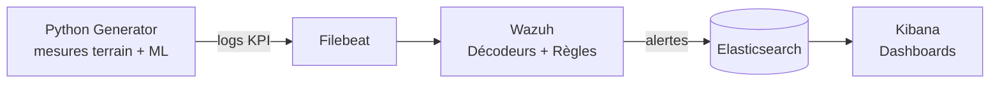

# SIEM KPI 4G/5G — Supervision Intelligente des Réseaux Mobiles

> Projet académique — Ingénierie des Réseaux Mobiles

Plateforme de supervision **temps réel** des KPI radio des réseaux mobiles (**RSRP, RSRQ** en LTE ; **RSCP, Ec/N0** en UMTS). Elle combine un **SIEM Wazuh** (règles de corrélation personnalisées) et un modèle de **Machine Learning (Isolation Forest)** pour détecter automatiquement les dégradations de couverture, les anomalies et les brouillages potentiels.

---

## Sommaire

- [Fonctionnalités](#fonctionnalités)
- [Architecture](#architecture)
- [Stack technologique](#stack-technologique)
- [Structure du dépôt](#structure-du-dépôt)
- [Démarrage rapide](#démarrage-rapide)
- [Accès aux services](#accès-aux-services)
- [Règles SIEM](#règles-siem)
- [Détection d'anomalies par ML](#détection-danomalies-par-ml)
- [Dataset](#dataset)
- [Dépannage](#dépannage)
- [Perspectives](#perspectives)

---

## Fonctionnalités

- Supervision temps réel des KPI 3G/4G (RSRP, RSRQ, RSCP, Ec/N0)
- Alertes SIEM par niveaux de gravité (WARNING à CRITIQUE) via des règles Wazuh personnalisées
- Détection d'anomalies non supervisée avec Isolation Forest
- Détection de brouillage potentiel par corrélation temporelle (5 chutes de signal en 60 s)
- Générateur de logs Python à partir de mesures terrain réelles
- Dashboards Kibana pour la visualisation et l'analyse
- Déploiement en une commande grâce à Docker Compose

---

## Architecture



**Flux de données :**

1. Le générateur Python rejoue les mesures terrain et produit des logs de KPI.
2. Filebeat collecte et achemine les logs.
3. Wazuh applique les règles de détection (seuils, corrélation, anomalies ML).
4. Les alertes sont indexées dans Elasticsearch.
5. Kibana expose les dashboards temps réel.

---

## Stack technologique

| Composant          | Rôle                                       |
| ------------------ | ------------------------------------------ |
| **Wazuh**          | SIEM et détection d'anomalies              |
| **Elasticsearch**  | Stockage et indexation                     |
| **Kibana**         | Dashboard temps réel                       |
| **Filebeat**       | Collecte de logs                           |
| **Python**         | Génération de logs + ML (Isolation Forest) |
| **Docker Compose** | Orchestration des services                 |

---

## Structure du dépôt

```text
siem-mobile-kpi/
├── filebeat/            # Configuration de la collecte de logs
├── python-generator/    # Générateur de logs KPI + modèle ML
├── wazuh/
│   └── rules/           # Règles de détection personnalisées
├── docker-compose.yml   # Orchestration de la stack complète
├── .gitignore
└── README.md
```

---

## Démarrage rapide

### Prérequis

- [Docker](https://docs.docker.com/get-docker/) et Docker Compose
- Au moins 4 Go de RAM disponibles (8 Go recommandés)
- Linux, macOS ou WSL2

### Installation

```bash
# 1. Cloner le dépôt
git clone https://github.com/d0ok/siem-mobile-kpi.git
cd siem-mobile-kpi

# 2. Prérequis système pour Elasticsearch
sudo sysctl -w vm.max_map_count=262144

# 3. Lancer la stack complète
docker-compose up -d

# 4. Vérifier l'état des conteneurs
docker-compose ps

# 5. Vérifier que les index sont créés
curl http://localhost:9200/_cat/indices?v
```

### Arrêt

```bash
docker-compose down        # arrêter les services
docker-compose down -v     # arrêter et supprimer les volumes (reset complet)
```

---

## Accès aux services

| Service           | URL                    |
| ----------------- | ---------------------- |
| Kibana Dashboard  | http://localhost:5601  |
| Elasticsearch API | http://localhost:9200  |
| Wazuh API         | http://localhost:55000 |

---

## Règles SIEM

| Rule ID | Niveau | Technologie | Description                             |
| ------- | :----: | :---------: | --------------------------------------- |
| 100001  |   12   |     LTE     | RSRP critique (< -100 dBm)              |
| 100002  |   7    |     LTE     | RSRP dégradé (WARNING)                  |
| 100003  |   12   |    UMTS     | RSCP critique (< -95 dBm)               |
| 100004  |   14   |     ML      | Anomalie détectée par Isolation Forest  |
| 100005  |   15   | Corrélation | Brouillage potentiel (5 chutes en 60 s) |

Les règles sont définies dans [`wazuh/rules/`](wazuh/rules).

---

## Détection d'anomalies par ML

Le modèle **Isolation Forest** (non supervisé) identifie les mesures qui s'écartent du comportement normal du réseau, sans nécessiter de données étiquetées. Les anomalies détectées remontent dans Wazuh sous forme d'alerte de niveau 14 (règle `100004`).

---

## Dataset

Mesures terrain réelles collectées lors de campagnes de drive-test :

| Dataset   | Technologie | Mesures | KPI         | Bandes |
| --------- | :---------: | ------: | ----------- | ------ |
| DT1       |  LTE (4G)   |  10 428 | RSRP, RSRQ  | 3 / 20 |
| DT2 / DT3 |  UMTS (3G)  |   8 332 | RSCP, Ec/N0 | 8      |

---

## Dépannage

| Problème                             | Solution                                                                   |
| ------------------------------------ | -------------------------------------------------------------------------- |
| Elasticsearch ne démarre pas         | Vérifier `vm.max_map_count` (voir installation)                            |
| Conteneurs qui redémarrent en boucle | Vérifier la RAM disponible (`docker stats`)                                |
| Aucun index visible                  | Attendre 1 à 2 min puis relancer `curl http://localhost:9200/_cat/indices?v` |
| Consulter les logs d'un service      | `docker-compose logs -f <service>`                                         |

---

## Perspectives

- Extension aux KPI 5G NR (SS-RSRP, SS-RSRQ, SINR)
- Export et versionnement des dashboards Kibana dans le dépôt
- Notifications d'alertes par e-mail, Telegram ou Slack
- Ré-entraînement automatique du modèle de détection d'anomalies
- Géolocalisation des anomalies sur une carte Kibana
- Intégration continue : lint et validation automatique des règles Wazuh
